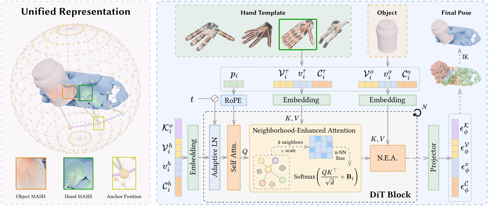
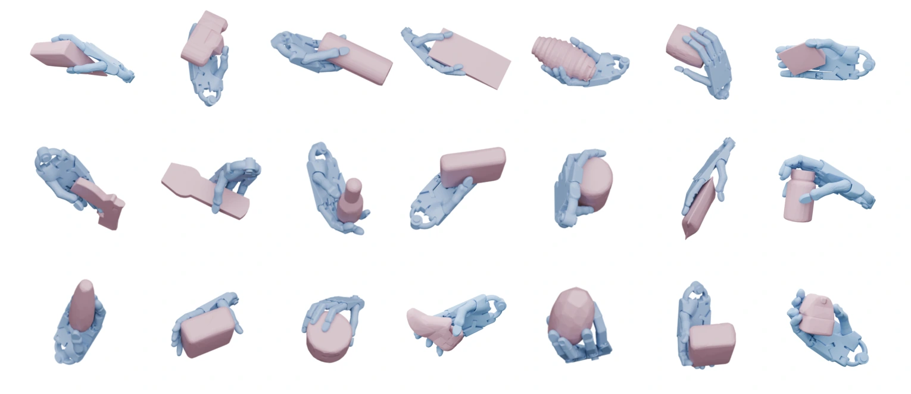
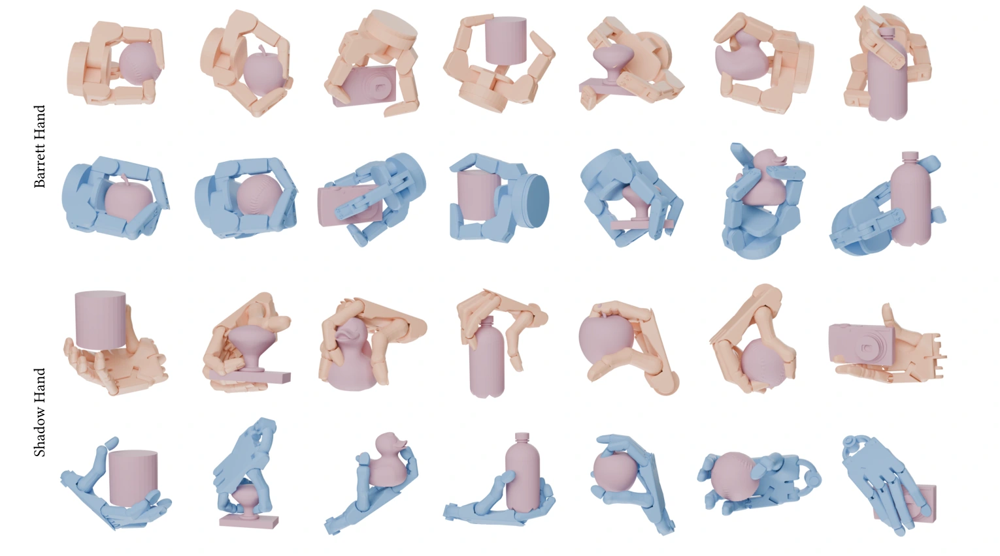

<div align="center">

<h1>InterMASH: A Unified Geometric Representation<br>for Grasp Synthesis</h1>

<p><strong>A unified geometric representation for dexterous grasp synthesis</strong></p>
<p><strong>SIGGRAPH Asia 2026 · Conference Papers</strong></p>
<p>
Xuanze Yang<sup>1</sup>, Yumeng Liu<sup>1,*</sup>, Haiyang Xin<sup>1</sup>,
Changhao Li<sup>1</sup>, Haowei Shen<sup>1</sup>, Kai Xu<sup>2</sup>,
Ligang Liu<sup>1</sup>, Ruizhen Hu<sup>3</sup>
</p>
<p>
<sup>1</sup> University of Science and Technology of China<br>
<sup>2</sup> Jiangsu Key Laboratory of AI for Industries and Institute of AI for Industries, Chinese Academy of Sciences<br>
<sup>3</sup> Shenzhen University<br>
<sup>*</sup> Corresponding author
</p>
<p>
<a href="https://arxiv.org/abs/2609.18504">Paper / arXiv</a> &nbsp;|&nbsp;
<a href="https://arxiv.org/pdf/2609.18504">PDF</a> &nbsp;|&nbsp;
<a href="https://inter-mash.github.io/">Project Page</a> &nbsp;|&nbsp;
<a href="#citation">BibTeX</a> &nbsp;|&nbsp;
Pretrained Models
</p>

</div>

This repository contains the implementation of [**InterMASH: A Unified Geometric Representation for Grasp Synthesis**](https://arxiv.org/abs/2609.18504), including MASH geometry encoding, conditional diffusion model training and sampling, and inverse kinematics (IK) post-processing for robotic hands.

## Method Overview

InterMASH establishes correspondence across hand embodiments using shared sphere-fixed anchors. At each anchor, low-degree spherical harmonics compactly encode local hand geometry, object geometry, and contact information. A conditional Diffusion Transformer jointly generates hand geometry and contact in this unified representation space, followed by IK to recover an articulated hand pose. The paper studies both human and robotic hands; the examples below focus on three robotic hands: Shadow, Allegro, and Barrett. See the [paper](https://arxiv.org/abs/2609.18504) for details.

1. **Geometry encoding:** Fit hand and object meshes to MASH parameters to obtain the geometry and contact information used by the model.
2. **Conditional generation:** Generate hand geometry and contact map parameters with a diffusion model conditioned on object geometry and a hand template.
3. **Kinematic fitting:** Sample hand point clouds from the generated MASH parameters and recover the global pose, joint angles, and hand mesh through IK.

<!-- Source: https://inter-mash.github.io/assets/images/method.webp -->


**Method overview.** The left panel shows the unified representation of hand and object geometry. The right panel conditions generation on the object and hand template, uses neighborhood-enhanced attention to model local patch relationships, and jointly generates hand geometry and contact. IK then recovers the articulated hand pose. Source: [project page](https://inter-mash.github.io/).

## Grasp Results

The following figures show results from the paper, as presented on the [project page](https://inter-mash.github.io/), including single-hand generation and cross-embodiment comparisons. See [Release Progress](#release-progress) for the status of the associated resources and code.

### Single-Hand Grasp Generation

<!-- Source: https://inter-mash.github.io/assets/images/grasps.webp -->


**ShadowHand grasp examples on DexGraspNet (Figure 8 in the paper).** The blue hands show grasps generated by InterMASH across different object geometries.

### Cross-Embodiment Grasp Comparison

<!-- Source: https://inter-mash.github.io/assets/images/cross-hand.webp -->


**Cross-embodiment comparison on filtered_CMapDataset (Figure 9 in the paper).** The top two rows show Barrett, and the bottom two show ShadowHand. For each hand type, the upper row shows D(R, O), and the lower row shows InterMASH in blue. See the [project page](https://inter-mash.github.io/) for additional visualizations, quantitative results, and evaluation protocols.

## Release Progress

Checked items are complete. Documentation, resource releases, and reproduction validation are tracked separately.

- [x] Provide an README covering installation, preprocessing, training, inference, and IK.
- [x] Add author affiliations, paper and project links, and the BibTeX citation.
- [x] Add method and grasp result visualizations.
- [x] Configure 9 Git submodules with HTTPS URLs and pinned dependency versions.
- [ ] Release pretrained weights, matching statistics, and MASH hand templates.
- [ ] Release robotic hand assets.
- [ ] Align preprocessing interfaces and complete contact map export for both hands and objects.
- [ ] Standardize IK input naming, path arguments, and result export.

## Repository Structure

```text
InterMASH/
├── docs/images/              # Method and grasp visualizations for the README
├── ma-sh/                    # MASH representation, C++/CUDA extensions, and geometry conversion
│   ├── convert/              # Dataset MASH fitting entry points
│   ├── dataset/              # Object sampling templates and HDF5 packing
│   └── ma_sh/                # MASH models and fitting implementations
├── mash_hoi/
│   ├── Preprocess/           # Auxiliary point cloud and normal preprocessing
│   └── source/
│       ├── Config/           # Hydra experiment configurations
│       ├── Demo/             # Training and inference entry points
│       ├── Model/            # Diffusion models
│       ├── Module/           # Data loading, networks, and loss functions
│       └── PostProcess/      # IK post-processing
├── third_party/              # Third-party tools
└── pyproject.toml            # Python package configuration
```

## Data and Pretrained Models

The examples use `ddpm_dga_loss_dro_handcmap.yaml` and the **filtered version of CMapDataset released by D(R, O) Grasp**, referred to here as `filtered_CMapDataset`. The corresponding paper is [D(R, O) Grasp: A Unified Representation of Robot and Object Interaction for Cross-Embodiment Dexterous Grasping](https://arxiv.org/abs/2410.01702).

The dataset is available through the [D(R, O) Grasp project page](https://nus-lins-lab.github.io/drograspweb/) and its [official data release](https://github.com/zhenyuwei2003/DRO-Grasp/releases/tag/v1.0). The upstream `data.zip` includes `CMapDataset_filtered/`, object meshes in `data_urdf/object/`, and robot URDFs in `data_urdf/robot/`. See `CMapDataset_filtered/README.md` inside the archive for dataset details.

This repository fits MASH representations to the filtered dataset and packs them into HDF5 files. `dataset.data_name=HandCMap-CMapDataset` selects the corresponding data loader in this project. The upstream archive does not include this project's MASH parameters, hand templates, normalization statistics, or InterMASH weights. When using upstream robot assets, verify that their mesh topology matches the hand models and sampling templates used by the IK pipeline.

Pretrained model download links, matching configurations, and result descriptions will be released later. When training your own model, retain the training statistics and hand templates to keep inference inputs consistent with training.

The following resources are not yet included in this repository. `<hand>` denotes `shadow`, `allegro`, or `barrett`; resources containing this placeholder must be prepared separately for each hand.

| Resource | Files / contents | Preparation |
| --- | --- | --- |
| Pretrained model | `best_model.ckpt` | Download link to be released |
| Training data | `<hand>_train_data.h5`, 3 files | Pack preprocessed MASH samples into HDF5 |
| Inference data | `test_data.h5` | Pack MASH parameters of test objects into HDF5 |
| Normalization statistics | `<hand>_statistics.npy`, 3 files | Generated during training initialization; inference requires the version matching the checkpoint |
| MASH hand templates | `mash_sphere_<hand>_template.npy`, 3 files | Resources and generation instructions to be added |
| Hand sampling templates | `sphere_<hand>_template.npy`, 3 files | Must include the spherical patch ordering `permutation`; the complete generation workflow is pending |
| Raw data and splits | filtered_CMapDataset, object meshes, `split_train_validate_objects.json` | Available from the [D(R, O) Grasp data release](https://github.com/zhenyuwei2003/DRO-Grasp/releases/tag/v1.0); the complete export workflow for this project is pending |
| Robot assets | URDFs and meshes for all three hands | The upstream archive provides `data_urdf/robot/`; documentation of the versions used by this project's IK pipeline is pending, and mesh topology must match the templates |

## Installation

### 1. Base Environment and Submodules

The installation example below follows the project development environment. Full installation validation in a clean environment is still pending.

| Component | Version |
| --- | --- |
| Operating system | Ubuntu |
| Python | 3.10 |
| PyTorch | 2.6.0 |
| CUDA Toolkit | 12.4 |
| GCC | 11.4.0 |

The project includes C++/CUDA extensions. Building them requires a visible NVIDIA GPU, the CUDA Toolkit (including `nvcc`), and compiler tools.

The public repository URL will be added later. Replace `<OWNER>/<REPOSITORY>` in the clone command with the final repository address. If you already have a Git working copy, skip cloning and run the submodule initialization command.

```bash
git clone --recurse-submodules "https://github.com/<OWNER>/<REPOSITORY>.git" InterMASH
cd InterMASH

# Initialize submodules at the commits recorded by the repository
git submodule update --init --recursive
export PROJ_HOME="$PWD"

conda create -n intermash python=3.10 -y
conda activate intermash

sudo apt-get update
sudo apt-get install -y build-essential cmake ninja-build \
  liboctomap-dev libfcl-dev libgl1 libgl1-mesa-dev

# Adjust this path to your local CUDA installation
export CUDA_HOME=/usr/local/cuda-12.4
export PATH="$CUDA_HOME/bin:$PATH"
export LD_LIBRARY_PATH="$CUDA_HOME/lib64:${LD_LIBRARY_PATH:-}"
export CC="$(command -v gcc)"
export CXX="$(command -v g++)"
```

### 2. Python Dependencies

Install PyTorch before building extensions that depend on it. The root `pyproject.toml` declares only part of the dependencies; additional packages are required for geometry processing, collision detection, and IK.

```bash
python -m pip install -U pip setuptools wheel ninja
python -m pip install torch==2.6.0 --index-url https://download.pytorch.org/whl/cu124
python -m pip install torch-scatter \
  -f https://data.pyg.org/whl/torch-2.6.0+cu124.html

python -m pip install trimesh matplotlib opencv-python einops \
  numpy open3d scipy scikit-learn tqdm numba icecream jax \
  tensorboard tensorboardX rootutils python-fcl \
  pytorch-kinematics transforms3d rtree liger-kernel pyglet==1.5.13
```

### 3. Geometry Dependencies and MASH Extensions

Run the following commands from the repository root. Each parenthesized command runs in a subshell, so its `cd` does not change the outer shell's working directory.

```bash
(cd "$PROJ_HOME/data-convert" && bash setup.sh)
(cd "$PROJ_HOME/sdf-generate" && bash setup.sh)
(cd "$PROJ_HOME/chamfer-distance" && python -m pip install . --no-build-isolation)
(cd "$PROJ_HOME/mesh-sample" && bash setup.sh)
(cd "$PROJ_HOME/nvdiffrast" && python -m pip install . --no-build-isolation)
(cd "$PROJ_HOME/pytorch3d" && python -m pip install . --no-build-isolation)
(cd "$PROJ_HOME/mesh-graph-cut" && bash setup.sh)

(cd "$PROJ_HOME/ma-sh" && bash compile.sh)
python -m pip install -e "$PROJ_HOME/ma-sh" --no-build-isolation
python -m pip install -e "$PROJ_HOME" --no-build-isolation
```

Follow each submodule's installation instructions for any additional system dependencies. The template partitioning scripts import `mesh_cut.Module.average_mesh_cutter`; verify that `mesh_cut` is importable after installation. A submodule's directory name may differ from its Python package name.

`ma-sh/compile.sh` sets `CUDA_HOME` to `/usr/local/cuda` if it finds `/usr/local/cuda/include/cuda_runtime.h`. If multiple CUDA versions are installed, check that this path points to the intended version before compiling.

If you use WNNC for normal estimation, also install its extension. The HandCMap training and inference commands in this guide do not require precomputed WNNC normal caches.

```bash
(cd "$PROJ_HOME/third_party/WNNC/ext" && python -m pip install . --no-build-isolation)
```

### 4. Verify the Installation

```bash
nvcc --version
python -c "import torch; print(torch.__version__, torch.version.cuda); assert torch.cuda.is_available()"
python -c "import mash_cpp, ma_sh, mash_hoi, pytorch3d, fcl, pytorch_kinematics; print('Core dependencies imported successfully')"
python -c "from mesh_cut.Module.average_mesh_cutter import AverageMeshCutter; print('Template partitioning dependency imported successfully')"
```

`ma-sh/test_environment.py` loads specific example meshes and templates and runs a conversion. It is not a standalone dependency check; prepare the referenced files under `ma-sh/data/` before running it.

## Dataset Preprocessing

This section converts filtered_CMapDataset into the MASH data used for training and inference: export meshes and contact maps, prepare sampling templates, fit per-sample MASH parameters, and pack them into HDF5 files. If you already have compatible HDF5 files and templates, proceed to [Training](#training) or [Inference](#inference).

### 1. Paths and Required Data

Run the commands below from the repository root with the following environment variables. Replace `/path/to/...` with **absolute paths** on your machine. Set these variables again when opening a new terminal.

```bash
export PROJ_HOME="$PWD"
export CMAP_ROOT=/path/to/DRO-Grasp/data/CMapDataset_filtered
export OBJECT_ROOT=/path/to/data_urdf/object
export RAW_ROOT=/path/to/DRO-Original
export TEMPLATE_ROOT=/path/to/template_info
export OBJECT_TEMPLATE_ROOT=/path/to/object_template
export DATA_ROOT=/path/to/HandCMap-Sphere-CMapDataset
export RESULT_ROOT="$PROJ_HOME/outputs/filtered-cmap"

mkdir -p "$DATA_ROOT" "$OBJECT_TEMPLATE_ROOT" "$RESULT_ROOT"
```

The `filtered_CMapDataset` name used here refers to `CMapDataset_filtered/` in the upstream archive. Point `CMAP_ROOT` to that directory. It must contain `split_train_validate_objects.json`, with `train` and `validate` object lists. Object identifiers follow the `<category>+<object_name>` format, such as `contactdb+apple`.

Prepare the following resources separately. The repository does not include the complete dataset, hand model assets, or trained weights.

| Resource | Expected location / purpose |
| --- | --- |
| Split file | `$CMAP_ROOT/split_train_validate_objects.json` |
| Original object meshes | `$OBJECT_ROOT/<category>/<object_name>/<object_name>.stl` |
| Exported training samples | Hand meshes, object meshes, and contact maps under `$RAW_ROOT/<hand>/train/` |
| Sampling templates | `$TEMPLATE_ROOT/sphere_<hand>_template.npy`, used for MASH fitting and IK |
| MASH hand templates | `$TEMPLATE_ROOT/mash_sphere_<hand>_template.npy`, used by the diffusion model |
| Robot assets | URDFs and referenced mesh files matching the dataset's hand models and mesh topology |

Here, `<hand>` is `shadow`, `allegro`, or `barrett`. Sampling templates must contain `submesh_num`, `points_per_submesh`, `triangle_ids`, `barycentric_coords`, and `permutation`. This workflow uses 256 patches with 1,024 sampled points per patch. MASH hand templates contain `mask_params`, `sh_params`, and `ortho_poses` under `hand_params`. These two types of templates serve different purposes and are not interchangeable.

The converters read **exported PLY/NumPy files, not raw grasp records**. Use the dataset's accompanying tools to export the following structure, keeping meshes and contact maps in the same coordinate frame:

```text
DRO-Original/
├── shadow/train/
│   ├── shadow_contactdb+apple_0_hand.ply
│   ├── shadow_contactdb+apple_0_object.ply
│   └── shadow_contactdb+apple_0_cmap.npy
├── allegro/train/...
└── barrett/train/...
```

### 2. Prepare Sampling Templates

Use [object_template_dro.py](ma-sh/dataset/object_template_dro.py) to prepare object sampling templates:

```bash
python ma-sh/dataset/object_template_dro.py \
  --object_source_root "$OBJECT_ROOT" \
  --object_template_root "$OBJECT_TEMPLATE_ROOT" \
  --split_path "$CMAP_ROOT/split_train_validate_objects.json" \
  --submesh_num 256 \
  --points_per_submesh 1024
```

The output files are named `<category>+<object_name>.npy`. The script writes a temporary `test.ply` in the current directory, so do not run multiple template jobs in the same working directory concurrently.

Hand template entry points are [prepare_template.py](ma-sh/prepare_template.py) and [convert_hand.py](ma-sh/convert_hand.py). The former generates only a basic sampling template and does not produce the `permutation` required for spherical patch ordering; simply renaming its output to `sphere_<hand>_template.npy` is not sufficient. The latter specifies the hand type, input mesh, template, and output paths in its `__main__` block; configure these separately for each hand. If you already have both types of templates matching the experiment, use those files directly.

### 3. Fit Training Samples to MASH

The entry point is [sphere_convert_dro.py](ma-sh/convert/sphere_convert_dro.py). Once the interfaces have been aligned and the required resources are available, run the following for all three hands:

```bash
for hand in shadow allegro barrett; do
  python ma-sh/convert/sphere_convert_dro.py \
    --data_root "$RAW_ROOT/$hand/train" \
    --object_template_root "$OBJECT_TEMPLATE_ROOT" \
    --hand_template_path "$TEMPLATE_ROOT/sphere_${hand}_template.npy" \
    --hand_type "$hand" \
    --batch_size 8 \
    --num_workers 4 \
    --part_num 1 \
    --current_num 0 \
    --output_root "$DATA_ROOT/$hand/train"
done
```

Outputs are saved to `$DATA_ROOT/<hand>/train/*_hoi.npy`. Each file contains shared `positions` and geometry and contact map parameters for both the hand and object. The example uses a single partition. The current multi-partition implementation uses integer division and skips trailing samples when the sample count is not divisible by `part_num`. Reduce `batch_size` if you run out of GPU memory.

### 4. Prepare Objects for Inference

Inference requires only object geometry. The following entry point reads the `validate` list from the split file and generates shared object MASH data:

```bash
python ma-sh/convert/sphere_dro_test.py \
  --object_root "$OBJECT_ROOT" \
  --object_template_root "$OBJECT_TEMPLATE_ROOT" \
  --split_path "$CMAP_ROOT/split_train_validate_objects.json" \
  --output_root "$DATA_ROOT/test" \
  --batch_size 1 \
  --num_workers 4
```

This example uses `batch_size=1` to avoid an incomplete final batch with the script's fixed-size fitter. Outputs are saved to `$DATA_ROOT/test/<category>+<object_name>_object.npy`.

### 5. Pack Data into HDF5

If you already have compatible MASH `.npy` files, start here. The packing tool reads every `.npy` file in the input directory and opens the output HDF5 file in write mode. Do not mix templates or statistics with sample files in the same directory. Existing HDF5 files with the same output name will be overwritten.

```bash
for hand in shadow allegro barrett; do
  python ma-sh/dataset/npy2h5.py \
    --data_root "$DATA_ROOT/$hand/train" \
    --output_path "$DATA_ROOT/${hand}_train_data.h5" \
    --mode train
done

python ma-sh/dataset/npy2h5.py \
  --data_root "$DATA_ROOT/test" \
  --output_path "$DATA_ROOT/test_data.h5" \
  --mode test
```

Each HDF5 file uses `0`, `1`, ... as sample group names and stores the original filename in the `name` attribute. The HandCMap format is:

| Field | Training data | Test data |
| --- | --- | --- |
| `positions` | `(256, 3)` | `(256, 3)` |
| `hand_params` | `(256, 26)` | Not included |
| `object_params` | `(256, 26)` | `(256, 22)` |

Training parameters are concatenated as `mask(7) + sh(9) + ortho(6) + cmap(4)`. Test objects do not include contact maps. Do not mix this format with the separate `cmap_params` field expected by the older `CMapDataset` branch.

The resulting data directory is:

```text
HandCMap-Sphere-CMapDataset/
├── shadow_train_data.h5
├── allegro_train_data.h5
├── barrett_train_data.h5
├── test_data.h5
├── shadow_statistics.npy       # Generated when the training DataModule is first initialized
├── allegro_statistics.npy
├── barrett_statistics.npy
├── shadow/train/...
├── allegro/train/...
├── barrett/train/...
└── test/...
```

Statistics are computed from the training set, and inference must use the same statistics as training. When changing the training data or contact map format, move the old statistics files aside and regenerate them. This workflow does not require `Preprocess/precompute_object_pointclouds.py`, which follows a different file naming convention without hand-type prefixes.

## Training

Entry point: [mash_hoi/source/Demo/ExpDRO/train.py](mash_hoi/source/Demo/ExpDRO/train.py). Configuration: [ddpm_dga_loss_dro_handcmap.yaml](mash_hoi/source/Config/DRO/ddpm_dga_loss_dro_handcmap.yaml).

The training script defaults to the older `ddpm_dga_loss_dro` configuration, so **specify `--config-name` explicitly** as shown below. The current DataModule combines all three hand types for training; prepare all three training HDF5 files and all three MASH hand templates.

```bash
python mash_hoi/source/Demo/ExpDRO/train.py \
  --config-name ddpm_dga_loss_dro_handcmap \
  exp_name=filtered_cmap_handcmap \
  dataset.data_root="$DATA_ROOT" \
  dataset.template_mash_root="$TEMPLATE_ROOT" \
  dataset.batch_size=8 \
  dataset.num_workers=4 \
  trainer.devices='[0]' \
  trainer.fast_dev_run=False \
  trainer.max_epochs=300 \
  trainer.log_dir="$PROJ_HOME/runs" \
  diffusion_cfg.output_dir="$RESULT_ROOT/mash"
```

For an initial smoke check, change `trainer.fast_dev_run=False` to `True` to run a small number of batches. Restore it to `False` for full training.

| Parameter | Description |
| --- | --- |
| `dataset.data_root` | Directory containing HDF5 data and statistics |
| `dataset.template_mash_root` | Directory containing `mash_sphere_<hand>_template.npy` |
| `dataset.batch_size` / `num_workers` | Batch size and number of data loading workers |
| `trainer.devices` | GPU list; quote it to prevent shell expansion of square brackets |
| `trainer.max_epochs` | Number of training epochs |
| `diffusion_cfg.lr` | Learning rate; `1e-3` in the current configuration |
| `diffusion_cfg.diffuse_steps` | Number of diffusion steps; `1000` in the current configuration |
| `loss_cfg.lambda_collision` | Collision loss weight |

The model uses 22 dimensions for hand geometry and 4 dimensions for each of the two contact maps, with `model_cfg.d_in=d_out=30`. Keep the model architecture, data format, and templates consistent between training and inference.

Logs and the checkpoint saved at the end of training are stored under:

```text
runs/filtered_cmap_handcmap/version_<n>/
├── events.out.tfevents...
└── best_model.ckpt
```

`best_model.ckpt` is the final checkpoint saved manually after `trainer.fit()` completes; the filename does not mean that it was selected using a validation metric. The current validation DataLoader reuses the training set, and `check_val_every_n_epoch=2000` exceeds the default 300 training epochs. This setup does not provide an independent validation evaluation.

```bash
tensorboard --logdir "$PROJ_HOME/runs"
```

## Inference

Entry point: [mash_hoi/source/Demo/ExpDRO/sample.py](mash_hoi/source/Demo/ExpDRO/sample.py). Inference requires a trained checkpoint, the shared `test_data.h5`, and statistics and MASH hand templates for all three hands.

```bash
# Set the version number to match your training output
export CKPT_PATH="$PROJ_HOME/runs/filtered_cmap_handcmap/version_0/best_model.ckpt"

python mash_hoi/source/Demo/ExpDRO/sample.py \
  --config-name ddpm_dga_loss_dro_handcmap \
  dataset.data_root="$DATA_ROOT" \
  dataset.template_mash_root="$TEMPLATE_ROOT" \
  dataset.batch_size=8 \
  dataset.num_workers=4 \
  tester.devices='[0]' \
  tester.ckpt_path="$CKPT_PATH" \
  trainer.fast_dev_run=False \
  trainer.limit_test_batches=1.0 \
  diffusion_cfg.output_dir="$RESULT_ROOT/mash"
```

The script runs inference for `shadow`, `allegro`, and `barrett` in sequence. By default, it generates 100 samples per object for each hand type. This count is controlled by `SphereDROTestDataset.expand_num=100` in [data_dro_sphere_handcmap.py](mash_hoi/source/Module/DataModule/data_dro_sphere_handcmap.py) and is not currently exposed as a Hydra argument.

Example output:

```text
outputs/filtered-cmap/mash/
├── gen_shadow_contactdb+apple_object_0.npy
├── gen_shadow_contactdb+apple_object_1.npy
├── gen_allegro_contactdb+apple_object_0.npy
└── gen_barrett_contactdb+apple_object_0.npy
```

Each output contains `positions`, `hand_params`, and `object_params`, with `cmap_params` included for both the hand and object. These are generated MASH representations; IK is still required to obtain robot joint configurations. Existing files with the same name will be overwritten, so use a separate `diffusion_cfg.output_dir` for each experiment.

## IK Post-processing

IK fits the generated hand sample points to a robot kinematic model to recover the global pose, joint angles, and hand mesh. Batch processing entry points are:

| Hand | Script |
| --- | --- |
| Shadow | [dro_shadow_process.py](mash_hoi/source/PostProcess/dro_shadow_process.py) |
| Allegro | [dro_allegro_process.py](mash_hoi/source/PostProcess/dro_allegro_process.py) |
| Barrett | [dro_barrett_process.py](mash_hoi/source/PostProcess/dro_barrett_process.py) |

### 1. Configure Paths and File Names

These scripts do not currently expose path arguments through the command line. Edit the `__main__` block in each file:

| Variable | Value |
| --- | --- |
| `mash_root` | Absolute path to the inference output, i.e., `$RESULT_ROOT/mash` above |
| `urdf_path` | URDF file for the corresponding hand |
| `part_path` | Directory containing the meshes associated with the URDF |
| `template_info_path` | Corresponding `sphere_<hand>_template.npy` |
| `target_root` | IK output directory, e.g., `$RESULT_ROOT/ik/shadow` |

Use actual absolute paths in Python strings; the literal `"$RESULT_ROOT/mash"` will not expand automatically. The URDF, sampling template, and training data must use the same hand model and mesh topology.

The scripts read samples with consecutive indices `0..N-1`. Allegro and Barrett additionally require exactly `sample_num=100` samples per object. If inference processed only part of the test batches, complete the outputs or adjust the IK sample loading logic accordingly.

### 2. Run IK

After configuring the paths, resolving conflicts, and aligning file names, run the following from the repository root:

```bash
python mash_hoi/source/PostProcess/dro_shadow_process.py
python mash_hoi/source/PostProcess/dro_allegro_process.py
python mash_hoi/source/PostProcess/dro_barrett_process.py
```

All three entry points currently call `pure_geom_fit()`, which focuses on geometric fitting, with defaults of `num_iterations=500` and `stop_error=0.005`. The contact-constrained `fit()` calls remain commented out. Setting `use_cmap=True` in the constructor alone does not enable that contact-loss fitting workflow.

The Allegro and Barrett entry points pass `vis_id=5`. The fitter checks `vis_id < batch_size` even when `vis=False`. For tests with fewer samples or smaller batches, also set `vis_id=0` and ensure that each batch is nonempty.

The scripts use `transform_inv` to restore coordinates. Shadow and Barrett currently use identity matrices, while Allegro applies a Z-axis flip. If you use a custom export coordinate frame, align this transform with the original data transformation.

### 3. Output Format

Hand meshes are saved as `<hand>_<object_name>_<index>_hand.ply` under each `target_root/mesh/`. The `sample_qpos` entry in the PKL file stores grasp parameters grouped by object name:

```python
results["sample_qpos"][object_name]  # (num_samples, 3 + 6 + num_joints)
```

Each row contains the global translation (computed as `rot_mat @ global_transl` in the code), a 6D rotation representation, and joint angles. Decode rotations with `compute_rotation_matrix_from_ortho6d()` in [mesh_utils.py](mash_hoi/source/Utils/mesh_utils.py) to follow the fitter's convention. Joint ordering follows the corresponding fitter and URDF; verify it before integrating the output with a simulator.

## Citation

If you find this project useful for your research, please cite our [paper](https://arxiv.org/abs/2609.18504):

```bibtex
@inproceedings{yang2026intermash,
  title         = {{InterMASH}: A Unified Geometric Representation for Grasp Synthesis},
  author        = {Yang, Xuanze and Liu, Yumeng and Xin, Haiyang and Li, Changhao
                   and Shen, Haowei and Xu, Kai and Liu, Ligang and Hu, Ruizhen},
  year          = {2026},
  booktitle     = {SIGGRAPH Asia 2026 Conference Papers},
  series        = {SA Conference Papers '26},
  publisher     = {Association for Computing Machinery},
  address       = {New York, NY, USA},
  location      = {Kuala Lumpur, Malaysia},
  isbn          = {979-8-4007-2842-6},
  numpages      = {11},
  doi           = {10.1145/3829340.3842336},
  url           = {https://doi.org/10.1145/3829340.3842336}
}
```
